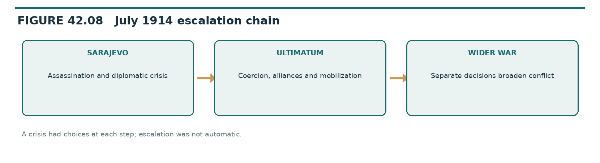

The assassination of Archduke Franz Ferdinand at Sarajevo on 28 June 1914 began a diplomatic crisis among governments already divided by imperial rivalries, Balkan nationalism and military competition. Austria-Hungary sought to punish Serbia and received German support. Russia was unwilling to accept Serbian defeat or the appearance of abandonment. France's alliance with Russia and Britain's strategic concerns widened the crisis. The Austrian ultimatum, the Serbian response, mobilization decisions and German war planning mattered at identifiable steps. The sequence was contingent: many earlier crises had ended without a general European war. \[<a href="/042-why-wars-begin/sources/#source-12" class="cite">12</a>\]

Several mechanisms interacted. Leaders misjudged one another's willingness to fight; Vienna and Berlin hoped that limited coercion might succeed; military timetables created pressures; and shifting perceptions of Russian power affected strategic expectations. Yet the parties were not equally responsible for every decision, and historians debate the relative weight of each government's choices. A security-dilemma interpretation can illuminate fear without replacing evidence of aggressive policy. To learn from 1914, construct a timeline of decisions and ask what each capital knew and could still choose at each stage.

<figure class="figure" id="figure-42-8">

<figcaption>Figure 42.8. July 1914 escalation chain. A crisis had choices at each step; escalation was not automatic. <a class="figure-anchor" href="#figure-42-8" aria-label="Link to this figure">#</a></figcaption>
</figure>
