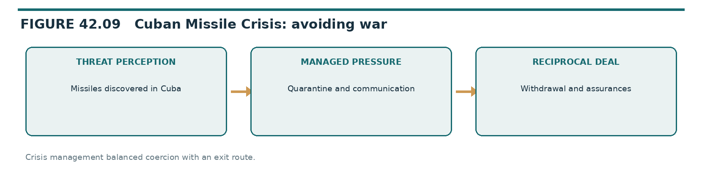

In October 1962 the United States discovered Soviet nuclear missiles being installed in Cuba. U.S. leaders interpreted them as a major strategic and political challenge; Soviet leaders sought to improve Cuba's security and alter the nuclear balance while taking a severe risk. The Kennedy administration rejected some immediate military options and imposed a naval quarantine. High-level communications, private bargaining and the willingness to remove missiles under negotiated conditions helped avert a direct U.S.–Soviet war. \[<a href="/042-why-wars-begin/sources/#source-14" class="cite">14</a>\]

The crisis shows the possibility and fragility of restraint under extreme danger. Messages were delayed or unclear, local commanders faced tense encounters, and not all participants controlled every weapon or deployment. A partial settlement involved Soviet missile withdrawal from Cuba and U.S. assurances not to invade the island, alongside a separate understanding concerning U.S. missiles in Turkey. Historians debate how close the world came to nuclear war, but the case clearly illustrates why reliable communication, control of forces, and face-saving agreements can matter when leaders have little time to decide.

<figure class="figure" id="figure-42-9">

<figcaption>Figure 42.9. Cuban Missile Crisis: avoiding war. Crisis management balanced coercion with an exit route. <a class="figure-anchor" href="#figure-42-9" aria-label="Link to this figure">#</a></figcaption>
</figure>
