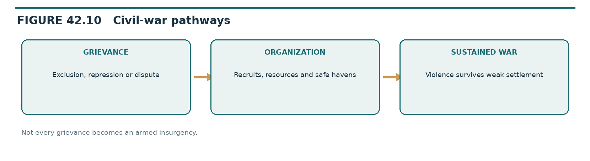

A civil war involves organized armed conflict within a state, though neighboring governments and international patrons may intervene. The parties may dispute the central government, regional autonomy, land, resources or the survival of a community. Civil wars can begin through failed political settlements, coups, repression, secessionist movements or the breakdown of state authority. Researchers debate how much ethnic division, poverty, geography, political exclusion and weak institutions increase risks. There is no reliable rule that diverse societies are naturally destined for violence. \[<a href="/042-why-wars-begin/sources/#source-17" class="cite">17</a>\]

Insurgencies are easier to sustain in some environments than others. Mountains and forests can complicate government control; porous borders allow supplies and refuge; administrative weakness may create openings for armed organizations. Yet military opportunity does not by itself tell us why people join a movement. Fear, ideology, local injustice, coercion, kinship, unemployment and survival strategies can all influence participation. For understanding civil wars, it is essential to ask who organizes violence, who finances it, how civilians are treated and which public institutions remain capable of settling disputes peacefully.

<figure class="figure" id="figure-42-10">

<figcaption>Figure 42.10. Civil-war pathways. Not every grievance becomes an armed insurgency. <a class="figure-anchor" href="#figure-42-10" aria-label="Link to this figure">#</a></figcaption>
</figure>
