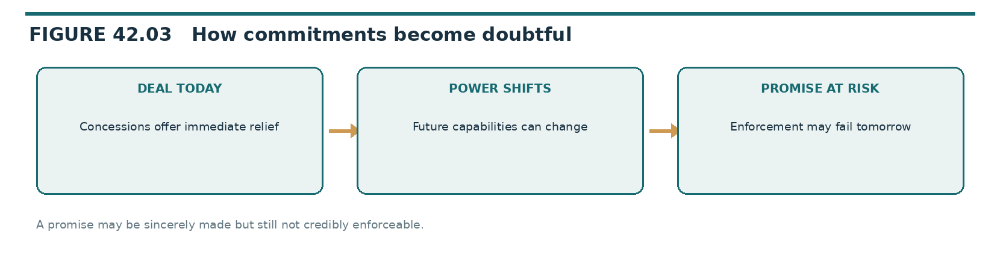

Suppose a strong state agrees not to attack a weaker neighbor in exchange for a withdrawal. Ten years later, the weaker state expects to become much stronger through population growth, new alliances or technology. The strong state may fear that today's promise will no longer constrain its neighbor when the balance changes. Likewise, a demobilized rebel movement may fear imprisonment or massacre after surrendering its weapons. Both cases raise a commitment problem: a proposed agreement allocates power now, but no trusted mechanism ensures that the parties will honor it when incentives change. \[<a href="/042-why-wars-begin/sources/#source-5" class="cite">5</a>\]

A commitment problem differs from ordinary lying. Leaders can sincerely promise peace and still fail to convince their opponents, because successors or future circumstances can overturn their intentions. This is why power-sharing, demilitarized zones, third-party guarantees and international monitoring can matter. But outside guarantors have limited resources and changing priorities, and they cannot automatically ensure compliance. A proposed peace should be evaluated not only by what it promises but by how violations will be detected, punished and remedied.

<figure class="figure" id="figure-42-3">

<figcaption>Figure 42.3. How commitments become doubtful. A promise may be sincerely made but still not credibly enforceable. <a class="figure-anchor" href="#figure-42-3" aria-label="Link to this figure">#</a></figcaption>
</figure>
