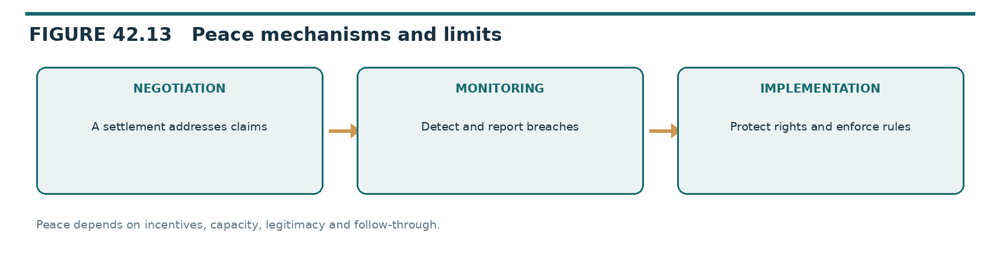

Diplomacy provides alternatives to military confrontation, but it is not a magic word. Mediation can help parties identify mutually acceptable terms; arbitration and adjudication can resolve some legal disputes; ceasefire monitoring can expose violations; peacekeeping may create space for political settlement. Other tools include electoral inclusion, credible protection of minority rights, fair policing, anti-corruption reform and economic arrangements that make renewed violence less attractive. The United Nations treats prevention as a combination of political, security, human-rights and development efforts rather than a single final meeting. \[<a href="/042-why-wars-begin/sources/#source-21" class="cite">21</a>\]

Every measure has limitations. Sanctions can hurt civilians and sometimes strengthen ruling coalitions; peacekeepers may lack mandates or resources; mediation can reward armed actors while excluding victims; constitutional bargains can become hollow without effective courts and administration. A ceasefire may stop shooting without resolving the dispute over territory or political authority. Responsible analysis specifies what a proposed intervention is intended to change, who must implement it, who can spoil it and how success will be measured. Ending battle deaths is an urgent achievement, but durable peace requires a longer institutional process.

<figure class="figure" id="figure-42-13">

<figcaption>Figure 42.13. Peace mechanisms and limits. Peace depends on incentives, capacity, legitimacy and follow-through. <a class="figure-anchor" href="#figure-42-13" aria-label="Link to this figure">#</a></figcaption>
</figure>
