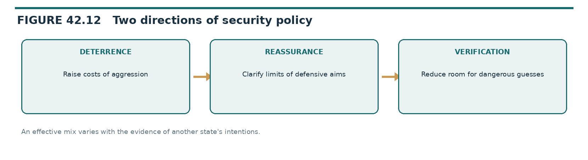

Deterrence seeks to prevent an adversary from choosing force by making the expected costs of aggression too high. A credible defensive alliance, capable armed forces and public commitment can discourage attack. But deterrence works through perceptions, not simply the possession of weapons. If leaders misread a warning or believe a defender will not honor its promise, military strength may fail to prevent war. Efforts to improve credibility can also look threatening, worsening a security dilemma.

Reassurance works in the other direction: governments communicate that their protective measures are not preparations for conquest. Arms-control agreements, inspections, military hotlines, explicit red lines, reciprocal withdrawals and crisis communication can reduce ambiguity. The correct balance depends on the situation. Reassurance of a genuinely aggressive state may encourage further coercion; a threatening posture toward a primarily defensive state may deepen its fear. Successful policy requires evidence about intentions and adaptability when those assessments prove wrong.

<figure class="figure" id="figure-42-12">

<figcaption>Figure 42.12. Two directions of security policy. An effective mix varies with the evidence of another state's intentions. <a class="figure-anchor" href="#figure-42-12" aria-label="Link to this figure">#</a></figcaption>
</figure>
