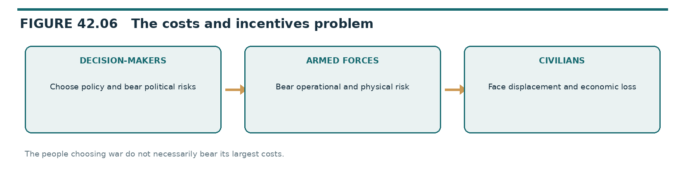

A war may be disastrous for a population yet attractive to the people who control the decision. A ruler might expect military success to strengthen their legitimacy, suppress a rival faction, distribute spoils to allies or prevent removal from office. A senior commander may receive promotions from an expanding military institution. Political leaders can also delay withdrawal from an unwinnable war because admitting defeat could endanger their position. In each case, the people who choose policies do not bear costs in the same way as soldiers and civilians.

This does not mean that every war is a cynical trick by rulers. Leaders can believe sincerely that they defend their communities, and democratic governments can wage aggressive wars. The useful question is whose preferences are represented in decision-making and how leaders are held accountable. Institutions that provide meaningful opposition, independent information, legislative scrutiny and public debate may constrain some risks, but they do not eliminate misinformation, fear or nationalist pressure. The distribution of political costs matters alongside the distribution of military capabilities. \[<a href="/042-why-wars-begin/sources/#source-8" class="cite">8</a>\]

<figure class="figure" id="figure-42-6">

<figcaption>Figure 42.6. The costs and incentives problem. The people choosing war do not necessarily bear its largest costs. <a class="figure-anchor" href="#figure-42-6" aria-label="Link to this figure">#</a></figcaption>
</figure>
