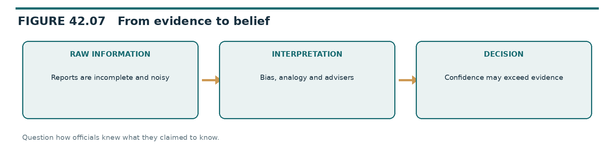

Decision-makers interpret incomplete information using mental shortcuts. They search for patterns, rely on recent memories and often interpret ambiguous evidence in ways that confirm existing beliefs. Confidence can grow inside a small advisory circle where dissent is discouraged. A military planner may mistake organizational neatness for operational feasibility; a politician may assume an opponent will yield because previous threats worked. Analysts refer to such patterns through ideas including confirmation bias, motivated reasoning and groupthink, although they are not universal explanations for poor decisions. \[<a href="/042-why-wars-begin/sources/#source-11" class="cite">11</a>\]

Historical analogies are particularly powerful. Calling a rival 'another Hitler' or comparing a disputed intervention to Vietnam may illuminate a danger, but it can also ignore differences in geography, institutions and political goals. An analogy is a hypothesis-generating tool, not proof. A useful discipline is to ask what facts would make the comparison invalid. Likewise, historians should avoid hindsight bias: once we know the result, we easily forget how uncertain events appeared to the participants at the time.

<figure class="figure" id="figure-42-7">

<figcaption>Figure 42.7. From evidence to belief. Question how officials knew what they claimed to know. <a class="figure-anchor" href="#figure-42-7" aria-label="Link to this figure">#</a></figcaption>
</figure>
