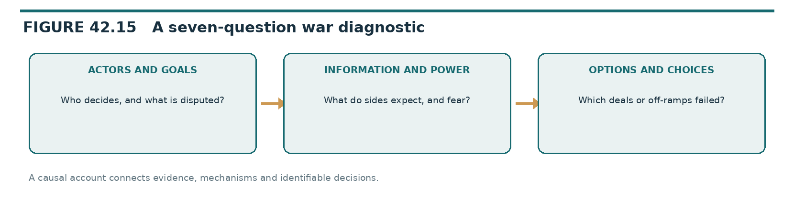

We began with a border crisis in which leaders believed they were safer preparing to fight than trusting a compromise. We can now ask sharper questions. What exactly was disputed? Which parties had the power to choose violence? What did each believe it could win, and at what cost? Was the danger an immediate attack, an anticipated future change, or a political threat at home? Which signals were misleading? Could a settlement be monitored or enforced? Did leaders have better information than the public, or less? Which events changed the calculation between tension and shooting?

The answer to 'why wars begin' is therefore neither a single list of human vices nor a law that predicts every conflict. Wars can arise from deliberate expansion, bargaining failures, commitment problems, fear, domestic coalitions, ideological goals, strategic opportunities and mistaken judgment in differing combinations. We can study these mechanisms without pretending that they erase human agency or responsibility. The next chapters will examine the geography of power, military logistics, diplomacy and law—tools that make these general insights more precise in particular historical and contemporary circumstances.

<figure class="figure" id="figure-42-15">

<figcaption>Figure 42.15. A seven-question war diagnostic. A causal account connects evidence, mechanisms and identifiable decisions. <a class="figure-anchor" href="#figure-42-15" aria-label="Link to this figure">#</a></figcaption>
</figure>
