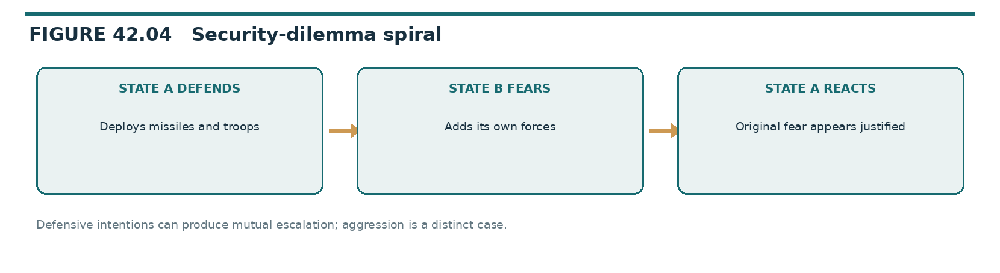

Imagine two states with no intention of invading one another. One builds fortifications and buys missiles to make itself safer. The other sees the missiles as a potential offensive threat and expands its own forces. The first now feels vindicated in its fears. An arms race can develop even though both sides would have preferred mutual restraint. This is the security dilemma, elaborated in classic work by John Herz and Robert Jervis. Its importance lies in separating fear generated by uncertainty from deliberate aggression, without pretending that aggression never occurs. \[<a href="/042-why-wars-begin/sources/#source-6" class="cite">6</a>\]

Security dilemmas become especially severe when weapons are hard to classify as offensive or defensive or when an attacker might gain a major first-strike advantage. They may ease when defensive measures are distinguishable, geography favors holding ground, and states can verify one another's posture. A security dilemma is not a synonym for any hostile relationship. If one government clearly intends conquest, describing the defender's preparations as the cause of mutual insecurity may create a misleading equivalence. Good analysis investigates intentions, capabilities and evidence separately.

<figure class="figure" id="figure-42-4">

<figcaption>Figure 42.4. Security-dilemma spiral. Defensive intentions can produce mutual escalation; aggression is a distinct case. <a class="figure-anchor" href="#figure-42-4" aria-label="Link to this figure">#</a></figcaption>
</figure>
