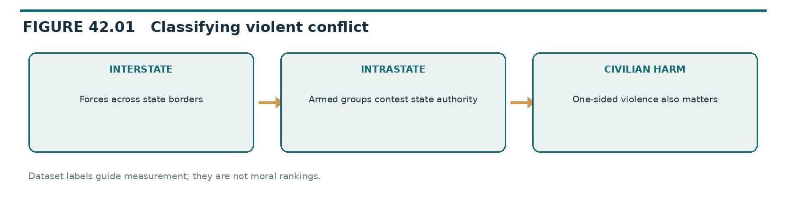

In ordinary conversation, war may describe everything from an international invasion to a civil conflict, an insurgency, a campaign of massacres, or a rivalry that never becomes violent. Researchers use narrower classifications so that different cases can be compared. The Uppsala Conflict Data Program (UCDP) defines state-based armed conflict using a dispute over government or territory, armed force between parties including at least one state government, and a threshold of at least 25 battle-related deaths in a calendar year. Within that dataset, 'war' means at least 1,000 battle-related deaths in a calendar year. These are research conventions, not moral verdicts about whether smaller-scale violence matters. \[<a href="/042-why-wars-begin/sources/#source-1" class="cite">1</a>\]

Counting battle deaths also leaves much suffering outside the measure. Disease, hunger, displacement, torture and violence directed at civilians require different datasets and definitions. An interstate war, a civil war and a campaign of one-sided mass killing can overlap without being identical. We should likewise distinguish the decision to start war from the decisions that prolong it, broaden it or make its violence exceptionally destructive. A framework useful for explaining an invasion may be insufficient for explaining a rebellion or a genocide. Careful analysis begins by stating the outcome we are trying to explain.

<figure class="figure" id="figure-42-1">

<figcaption>Figure 42.1. Classifying violent conflict. Dataset labels guide measurement; they are not moral rankings. <a class="figure-anchor" href="#figure-42-1" aria-label="Link to this figure">#</a></figcaption>
</figure>
