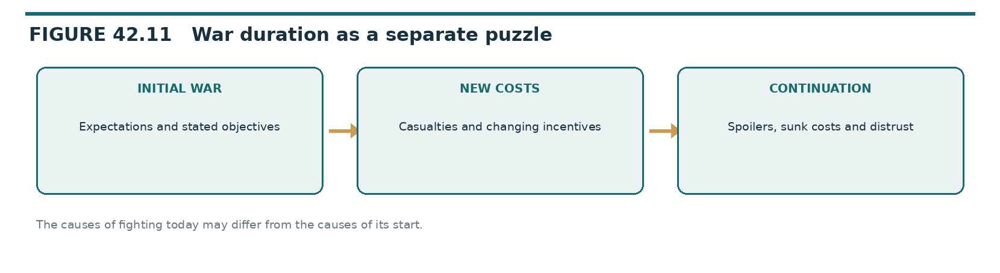

Starting a war and continuing it are different decisions. At the beginning, each side may think victory will be swift. After months of fighting, commanders acquire fresh information, but the parties may disagree about the meaning of losses, external support or newly changed political conditions. Leaders may gamble for resurrection, hoping that one more offensive will reverse an otherwise unacceptable outcome. New armed groups may profit from checkpoints, smuggling or control over assistance. Territorial changes and atrocities create additional grievances.

Sunk costs can distort judgment. The fact that thousands have already died cannot by itself make further deaths worthwhile; past costs are gone, while future choices must be assessed by their likely consequences. Yet leaders and supporters may see withdrawal as betrayal, making an unsuccessful war politically harder to end. Peace initiatives should therefore investigate whether the original objectives remain negotiable, which actors can veto settlement, and whether parties have enough confidence in the postwar arrangement to stop fighting. \[<a href="/042-why-wars-begin/sources/#source-19" class="cite">19</a>\]

<figure class="figure" id="figure-42-11">

<figcaption>Figure 42.11. War duration as a separate puzzle. The causes of fighting today may differ from the causes of its start. <a class="figure-anchor" href="#figure-42-11" aria-label="Link to this figure">#</a></figcaption>
</figure>
