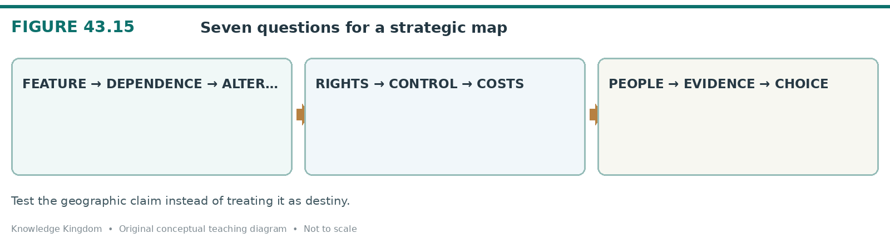

When you encounter a claim such as 'Country A is destined to dominate because it controls a sea passage,' ask seven questions. What geographic feature is involved? Which economic or military activities depend on it? What alternatives exist and at what cost? Who has legal rights and operational control? Which technologies and institutions change the outcome? Who experiences the benefits and harms? What evidence would show the claim to be false?

You may discover that the feature creates substantial influence but only under particular circumstances. You may find that analysts have exaggerated its importance by ignoring alternative routes. You may also find that a small community's local knowledge matters more than distant officials expected. This habit of testing spatial claims improves public debate and helps distinguish serious strategy from geographic mythology.

The goal of this chapter is not to replace political history with topography. It is to carry physical space into our explanations of trade, diplomacy, conflict and development—while preserving the place of institutions and human agency. Geography offers constraints and possibilities. Politics determines how they are used. The next chapter turns to military organization and logistics: how states attempt to convert territory, people and resources into forces capable of operating in the real world.

<figure class="figure" id="figure-43-15">

<figcaption>Figure 43.15. Seven questions for a strategic map. Test the geographic claim instead of treating it as destiny. <a class="figure-anchor" href="#figure-43-15" aria-label="Link to this figure">#</a></figcaption>
</figure>
