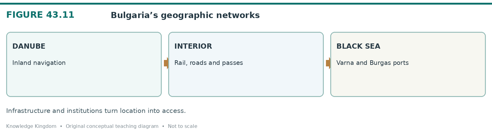

A freight journey crossing Bulgaria from the Danube toward the Aegean or Turkish border is shaped by rivers, bridges, tunnels, mountain passes, road quality and border procedures. The European Union's Rhine–Danube and other trans-European transport corridors highlight the importance of multimodal links across southeastern Europe. Official corridor maps identify priorities, but planned infrastructure should not be confused with completed, fully functioning capacity.

The Danube can support river transport, yet shallow periods, port limitations and differing national regulations affect navigation. Black Sea ports provide maritime access, while shipping depends on passage through the Turkish Straits and conditions on wider trade routes. Road and rail connections through Sofia, Plovdiv and other cities shape inland logistics. For rural regions, the quality of a local connecting road can matter more to daily life than a line representing a continent-wide corridor.

Strategic importance can yield both economic opportunities and obligations. A heavily used bridge requires maintenance; a logistics hub needs skilled workers, transparent procurement and efficient inspections. The case shows why geography is an invitation to make public choices rather than an automatic source of geopolitical advantage.

<figure class="figure" id="figure-43-11">

<figcaption>Figure 43.11. Bulgaria’s geographic networks. Infrastructure and institutions turn location into access. <a class="figure-anchor" href="#figure-43-11" aria-label="Link to this figure">#</a></figcaption>
</figure>
