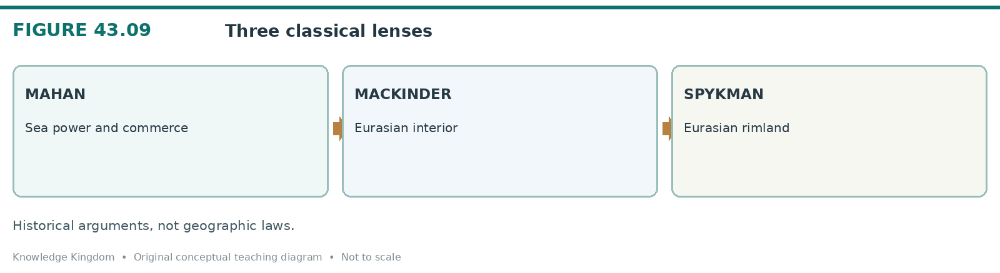

Geopolitics has a long and complicated intellectual history. Alfred Thayer Mahan emphasized maritime power; Halford Mackinder examined the strategic possibilities of inland Eurasia; and Nicholas Spykman gave importance to the coastal regions surrounding the Eurasian interior. These thinkers did not agree on which spaces mattered most. Their theories reflected the technologies, rivalries and political concerns of their own periods.

Mackinder's 1904 argument about the Eurasian 'pivot' considered how railways might alter the balance between land and sea power. Spykman later focused on the 'rimland,' the broad coastal belt around Eurasia. Neither term is a natural boundary that can be drawn with perfect scientific precision. Different authors and maps give them varying content. Their value lies in prompting us to examine mobility, concentration of resources and relationships among regions.

The danger appears when a theory becomes a prophecy. An assertion that whoever occupies one region 'must' dominate the globe ignores institutions, population, political resistance, technology and changing economies. Several geopolitical writers were used by imperial or authoritarian movements to justify expansion. A responsible reader treats classical geopolitical theories as historical arguments to evaluate, not commands for governments to follow.

<figure class="figure" id="figure-43-9">

<figcaption>Figure 43.9. Three classical lenses. Historical arguments, not geographic laws. <a class="figure-anchor" href="#figure-43-9" aria-label="Link to this figure">#</a></figcaption>
</figure>
