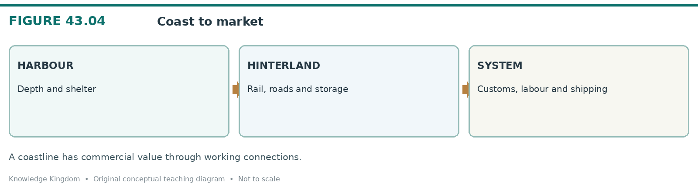

Coasts give access to fisheries, maritime transport, trade, tourism and naval activity. But a coastline is not the same thing as a good harbour. Depth, shelter, storm exposure, nearby population, road and rail connections, customs efficiency and the availability of capital all affect whether a port becomes important. A narrow, difficult or exposed coast may offer fewer opportunities than a well-connected river port inland.

Maritime shipping moves roughly four-fifths of international merchandise trade by volume, according to UN Trade and Development, though the share by trade value is lower. This is a reminder that sea transport remains fundamental even in an age of aviation and digital services. Bulk commodities and large container loads are especially sensitive to transport costs. At the same time, marine access requires maritime safety, insurance, infrastructure and the legal ability to pass through foreign waters.

A coastal city can connect distant markets while bringing new vulnerabilities: storm surges, sea-level rise, disruption of shipping, concentration of strategic assets and dependency on imported fuel. The best geographic question is not 'Does this country have a coast?' but 'How effectively and resiliently does it connect its people to maritime networks?'

<figure class="figure" id="figure-43-4">

<figcaption>Figure 43.4. Coast to market. A coastline has commercial value through working connections. <a class="figure-anchor" href="#figure-43-4" aria-label="Link to this figure">#</a></figcaption>
</figure>
