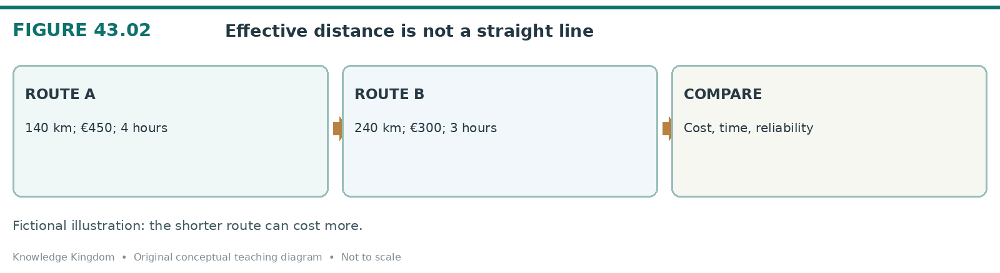

Two cities can be 500 kilometres apart and function as neighbors if a fast railway, open border and cheap freight service connect them. Another pair only 150 kilometres apart may be separated by mountains, poor roads, incompatible regulations and seasonal closures. Straight-line distance is therefore a weak guide to effective connectivity. Economists sometimes use the idea of economic distance: the time, expense, uncertainty and administrative friction required to move people, goods or information.

For a hypothetical illustration, compare routes serving a town. Route A is 140 kilometres and requires a four-hour mountain drive at a freight cost of 450 euros. Route B is 240 kilometres along a reliable highway at 300 euros. The shortest path is not the cheapest. If winter storms close Route A for ten days each year, the reliability difference grows. This example is invented to show how to reason, not a report of actual transport prices.

A state can reduce effective distance without moving its mountains. Bridges, efficient customs systems, fair transit agreements and secure digital networks can change a region's opportunities. Geography establishes the physical setting; investment and cooperation partly determine the price of overcoming it.

<figure class="figure" id="figure-43-2">

<figcaption>Figure 43.2. Effective distance is not a straight line. Fictional illustration: the shorter route can cost more. <a class="figure-anchor" href="#figure-43-2" aria-label="Link to this figure">#</a></figcaption>
</figure>
