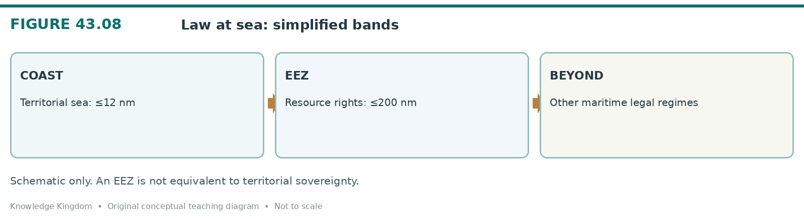

The ocean is not divided into identical sovereign territories. Under the UN Convention on the Law of the Sea, a coastal state may claim a territorial sea extending up to 12 nautical miles from applicable baselines. The treaty also provides for exclusive economic zones, generally up to 200 nautical miles, where coastal states have specified sovereign rights over resources and certain jurisdictional powers. An exclusive economic zone is not simply territorial land extended across the water.

Rights of passage, navigation and scientific activity depend on the relevant maritime zone and legal rules. In straits used for international navigation, particular passage regimes may apply. The treaty contains complex provisions for archipelagic waters, continental shelves and disputed maritime boundaries; a map with a broad shaded band around a coast cannot explain those rules by itself.

Maritime jurisdiction matters for fishing, offshore energy, environmental protection and strategic competition. But a claimed maritime zone does not guarantee the ability to patrol it. Law, enforcement resources and relations with other states all shape the practical outcome. A disciplined geographic analysis separates legal entitlement from political assertion and actual control.

<figure class="figure" id="figure-43-8">

<figcaption>Figure 43.8. Law at sea: simplified bands. Schematic only. An EEZ is not equivalent to territorial sovereignty. <a class="figure-anchor" href="#figure-43-8" aria-label="Link to this figure">#</a></figcaption>
</figure>
