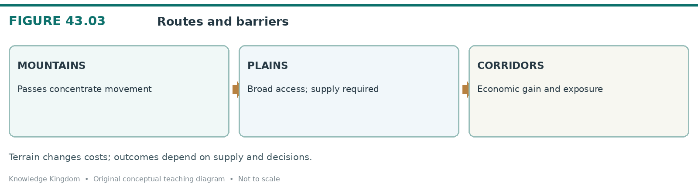

Broad lowlands often permit roads, railways, farming, settlement and rapid movement. For armies they may simplify logistics and manoeuvre, though rivers, forests, marshes and cities can interrupt seemingly open terrain. In eastern Europe, the vast plains have repeatedly featured in strategic calculations; yet actual campaigns depended on infrastructure, season, political coalitions, armies and local resistance, not on flatness alone.

A corridor is a route through which movement concentrates because alternatives are slower, more expensive or impossible. Some are physical, such as a valley between mountains. Others are created by rail lines or border arrangements. The corridor may produce wealth for cities along it while giving an opponent an obvious route to threaten. Building more connections can increase prosperity and strategic exposure at the same time.

The idea of strategic depth refers broadly to the space and capacity through which a country might absorb, delay or resist an attack. A large land area can provide depth, but not if communications collapse or the population cannot be supplied. Small countries can compensate through alliances, fortifications, mobility and resilience. Depth is a relationship between space, forces and institutions, not a prize awarded automatically by square kilometres.

<figure class="figure" id="figure-43-3">

<figcaption>Figure 43.3. Routes and barriers. Terrain changes costs; outcomes depend on supply and decisions. <a class="figure-anchor" href="#figure-43-3" aria-label="Link to this figure">#</a></figcaption>
</figure>
