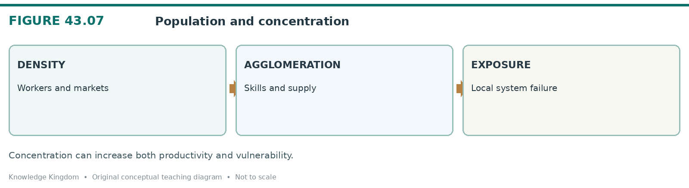

A large population can provide workers, consumers, soldiers, inventors and taxpayers. It also requires housing, healthcare, transport, education and food. Population size does not map directly onto power; productivity, demographic structure, social trust and institutions shape what a society can do with its people. Ageing, migration and urbanization change the pattern over time.

Economic activity often concentrates in a few cities or corridors because firms benefit from nearby customers, skilled labour and suppliers. This is called agglomeration. Concentration can raise output but also vulnerability: a flood, cyberattack or transport disruption in one metropolitan region may affect national production. The location of people is thus as important as the total population figure.

Maps of population density can mislead if treated as evidence of political loyalty. Border regions may contain several languages and identities, and migration reshapes communities. Strategic discussions that reduce inhabitants to 'human terrain' risk overlooking their rights and interests. States gain durable security not merely by occupying territory but by building institutions that people regard as legitimate and capable.

<figure class="figure" id="figure-43-7">

<figcaption>Figure 43.7. Population and concentration. Concentration can increase both productivity and vulnerability. <a class="figure-anchor" href="#figure-43-7" aria-label="Link to this figure">#</a></figcaption>
</figure>
