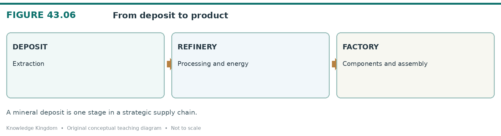

Oil, gas, metals, fertile land, freshwater and forests can support economic power. Yet possessing a resource is not the same as converting it into broad prosperity. Extraction requires technology, finance, transport, contracts, skilled labour, environmental management and institutions capable of collecting and using revenues. Price swings and political competition over resource income can destabilize an economy.

A deposit may be valuable because it is rare or difficult to replace, but a resource-intensive region can also depend on distant customers, spare parts or processing facilities. Strategic vulnerability often lies in an entire supply chain rather than the mine itself. A country that extracts ore may still import refined metal, machine tools or chemicals needed for its own industry.

The so-called resource curse is a debated pattern, not a universal rule. Some resource exporters develop capable institutions and diversified economies; others suffer corruption, conflict or boom-and-bust cycles. Researchers ask when revenue strengthens public services and when it encourages elites to capture the state. Geography can open a financial opportunity, while decisions about taxation, transparency and investment determine its wider consequences.

<figure class="figure" id="figure-43-6">

<figcaption>Figure 43.6. From deposit to product. A mineral deposit is one stage in a strategic supply chain. <a class="figure-anchor" href="#figure-43-6" aria-label="Link to this figure">#</a></figcaption>
</figure>
