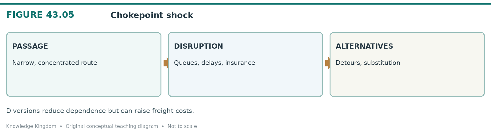

A chokepoint is a narrow passage through which many journeys converge. The Suez Canal connects the Mediterranean and Red seas; the Panama Canal connects Atlantic and Pacific routes; the Strait of Malacca joins the Indian Ocean with maritime routes to East Asia; Hormuz links the Persian Gulf with the Gulf of Oman; and the Turkish Straits connect the Black Sea with the Mediterranean system. Their strategic significance arises from the amount and type of movement they channel.

Chokepoints do not create absolute control over the world economy. Ships may divert, pipelines may bypass particular routes, and countries may adjust production or storage. But detours take time, consume fuel, raise insurance costs and shift congestion elsewhere. UNCTAD's maritime transport reporting illustrates how disruptions can increase the number of tonne-miles travelled even when the total cargo volume changes little.

A government with territory beside a chokepoint does not automatically possess unlimited rights to stop foreign traffic. International treaties, passage regimes, commercial incentives, naval capabilities and other states' responses matter. It is important to distinguish geographic location, legal jurisdiction, actual operational control and the power to influence shipping costs.

<figure class="figure" id="figure-43-5">

<figcaption>Figure 43.5. Chokepoint shock. Diversions reduce dependence but can raise freight costs. <a class="figure-anchor" href="#figure-43-5" aria-label="Link to this figure">#</a></figcaption>
</figure>
