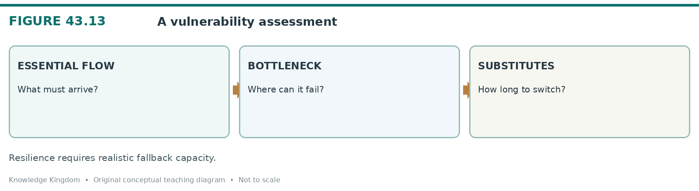

A state becomes vulnerable when an important need relies on a route, facility, supplier or decision it cannot easily replace. This is a more useful concept than simply counting land borders or kilometres of coastline. A well-connected country may be resilient if it has alternative routes; a country with ample resources may be fragile if one processing facility supplies its entire industry.

A practical test has four steps. First, identify the essential flow: grain, fuel, electricity, medicine, finance or communication. Second, locate the bottleneck. Third, estimate realistic substitutes and how long they take to activate. Fourth, ask who would bear the consequences of a failure. Governments should then evaluate the price of redundancy against the risk of disruption. These are policy choices that can be assessed rather than proclaimed.

For a hypothetical example, a coastal state imports 60 percent of an industrial input through one port. A second port can handle only one-quarter of that flow in an emergency. The immediate shortfall could be substantial even though the state has a long coastline. This is a fictional exercise; its purpose is to show why logistics capacity matters more than the visual extent of a feature on a map.

<figure class="figure" id="figure-43-13">

<figcaption>Figure 43.13. A vulnerability assessment. Resilience requires realistic fallback capacity. <a class="figure-anchor" href="#figure-43-13" aria-label="Link to this figure">#</a></figcaption>
</figure>
