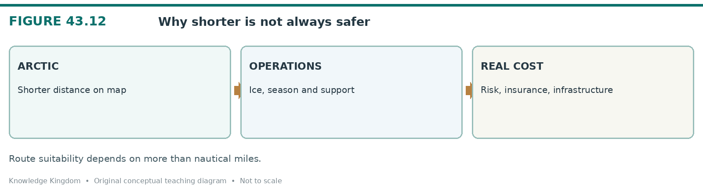

As Arctic sea ice conditions change, commentators sometimes describe a new age in which northern routes will automatically replace established shipping lanes. This is too simple. Seasonal ice, unpredictable weather, limited rescue capabilities, specialized vessels, insurance, port infrastructure and environmental risks complicate operations. A shorter map distance does not guarantee a cheaper or safer voyage.

The Arctic also contains Indigenous communities whose livelihoods, knowledge and rights should be central to discussions of development and security. Competition over resources, shipping regulation and military activity is only part of the story. Conservation, scientific cooperation, fisheries and local participation matter as well. Treating a changing climate simply as a strategic opportunity misses its harms and uncertainties.

Geographers should distinguish observed environmental change from speculative geopolitical predictions. A route may be navigable under certain conditions without being reliable for year-round commercial schedules. An oil or mineral deposit may exist but remain uneconomic or environmentally unacceptable to extract. The Arctic reminds us that technology may open possibilities while nature and governance continue to limit what is feasible.

<figure class="figure" id="figure-43-12">

<figcaption>Figure 43.12. Why shorter is not always safer. Route suitability depends on more than nautical miles. <a class="figure-anchor" href="#figure-43-12" aria-label="Link to this figure">#</a></figcaption>
</figure>
