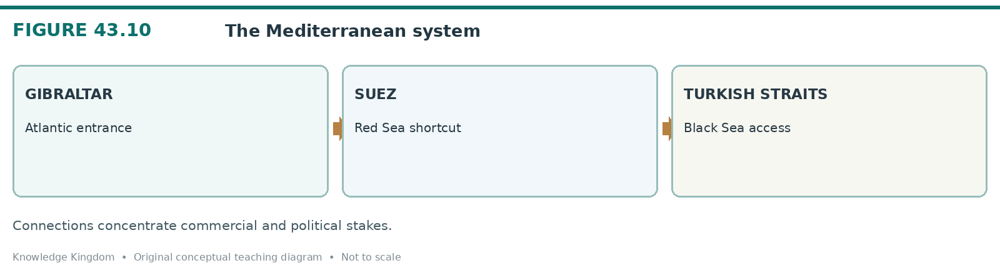

The Mediterranean is an enclosed sea connected to the Atlantic through Gibraltar and to the Red Sea via the Suez Canal. The Turkish Straits connect the Black Sea to the broader maritime system. These passages help explain the region's historical importance for commerce and security, but the sea is not a uniform strategic space. Its northern, southern and eastern shores contain societies with distinct political histories and economic interests.

Changing transportation technology transformed Mediterranean geography. Before the Suez Canal opened in 1869, trade between Europe and Asia generally faced different sea-route costs. The canal made one route much shorter for many journeys, creating new commercial opportunities and exposure to disruption. Its strategic significance later depended on shipping technology, international agreements, the governments involved and global trade patterns.

The same waterway can be described as a gateway or as a vulnerability. What matters is who relies on the route, whether alternatives exist and how a disruption affects different users. Geographic discussions about the Mediterranean should also include coastal communities, fisheries, migration, environmental concerns and the legal rights of ships and passengers—not merely the competition of outside navies.

<figure class="figure" id="figure-43-10">

<figcaption>Figure 43.10. The Mediterranean system. Connections concentrate commercial and political stakes. <a class="figure-anchor" href="#figure-43-10" aria-label="Link to this figure">#</a></figcaption>
</figure>
