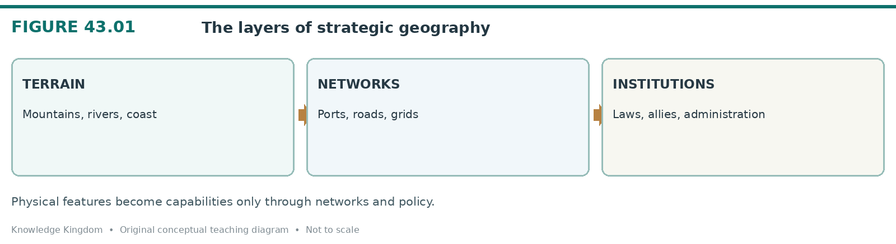

Power is the capacity to influence outcomes, but its components differ. A state may possess a large army yet lack the transport capacity to move that army. It may control valuable minerals but be unable to process them economically. A small country may influence international bargaining because an important port, financial service or communications junction lies within its territory. Thus territorial size and strategic influence are not synonymous.

Distinguish resources from capabilities and capabilities from outcomes. A mountain is a geographic feature; a tunnel is infrastructure; the ability to operate the tunnel reliably is institutional capacity. An airport is useful only when aircraft, technicians, fuel, secure access and political permission are available. The same object can be a commercial asset in peacetime and a logistical vulnerability in war. Power also includes legitimacy: a government cannot simply treat the residents of a valley as interchangeable dots on a map.

A helpful analytical sequence is location, access, network, control, costs and choice. The sequence encourages precise questions. Where is the feature? Who can reach it? What systems depend on it? Who actually controls those systems? What alternatives exist? Which policies could alter the result? It is the foundation for every geographic case that follows.

<figure class="figure" id="figure-43-1">

<figcaption>Figure 43.1. The layers of strategic geography. Physical features become capabilities only through networks and policy. <a class="figure-anchor" href="#figure-43-1" aria-label="Link to this figure">#</a></figcaption>
</figure>
