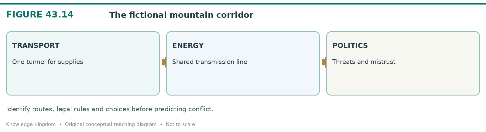

Return to our opening fictional country. Two states share a mountain corridor containing one tunnel, a hydropower line and a road carrying medicine and food. A border incident prompts one state to threaten closure. The other announces military exercises nearby. Public arguments describe the tunnel as a historic national lifeline. The physical geography is straightforward; the crisis arises from interacting economic, security and political factors.

Start by mapping the flows. Who uses the road? Are there alternative routes? Can the electricity line be repaired quickly? Do winter conditions affect access? Next map the institutions: who operates the tunnel, collects tolls, issues permits and monitors incidents? Finally identify the decision makers and incentives. If each government fears that a concession will invite future pressure, this is a commitment problem. If commanders interpret repairs as preparation for attack, it may also be a security dilemma.

Possible measures include joint inspections, neutral monitoring, emergency transit rules, redundant energy connections and credible dispute-resolution procedures. None guarantees peace, but each addresses a particular mechanism. The example shows how geographic analysis can support practical negotiation rather than merely predict conflict.

<figure class="figure" id="figure-43-14">

<figcaption>Figure 43.14. The fictional mountain corridor. Identify routes, legal rules and choices before predicting conflict. <a class="figure-anchor" href="#figure-43-14" aria-label="Link to this figure">#</a></figcaption>
</figure>
