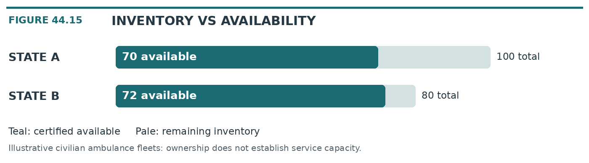

Return to the fictional states at the opening of the chapter. Instead of imagining combat, compare their public emergency-service fleets. State A owns 100 ambulances, of which 70 are certified as available for their ordinary duties on a particular reporting date. State B owns 80, of which 72 are certified as available under the same definition. A has a larger inventory, but B has slightly more available ambulances. A's availability rate is 70 divided by 100, or 70 percent; B's is 72 divided by 80, or 90 percent.

Does B have the better emergency service? Not enough information. The vehicles may serve different populations, have different staffing arrangements and travel different distances. An availability snapshot says nothing directly about response times, medical outcomes, service equity or the resilience of the system during a disaster. Nevertheless, it exposes the error of equating ownership with usable capacity. The same logical caution applies to published military inventories.

Now suppose A spends 120 million currency units annually and B spends 100 million. We still cannot determine comparative effectiveness: expenditure includes different costs, and the geographical and demographic requirements of each service differ. The lesson is to identify the relevant outcome, choose comparable indicators and keep track of uncertainty. These figures are entirely fictional and concern civilian services, not estimates of actual military requirements.

<figure class="figure" id="figure-44-15">

<figcaption>Figure 44.15. Illustrative civilian ambulance fleets: ownership does not establish service capacity. <a class="figure-anchor" href="#figure-44-15" aria-label="Link to this figure">#</a></figcaption>
</figure>
