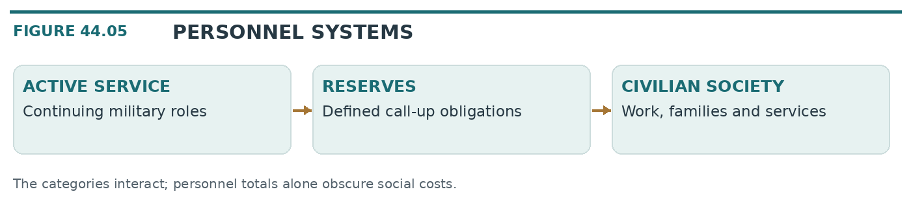

Active personnel serve in military roles on a continuing basis; reservists have obligations or commitments that allow them to be called upon under specified conditions. The legal arrangements differ by country. Mobilisation is the broader process by which a state activates personnel, institutions and resources in response to a national requirement. It is not simply another word for recruitment.

Consider a nurse, a railway engineer and a software specialist who have reserve obligations. Their civilian occupations may be essential to the same society that calls them into military service. Moving a large number of people into one institution can leave another short of staff. This creates a difficult economic and social question: how should a country allocate scarce human skills while maintaining health care, production and public services?

A reserve total is not an adequate measure of preparedness. The date of the last training, health and age profiles, legal eligibility and administrative records matter. Mobilisation also entails public consent, compensation, family responsibilities and the rights of individuals. States differ in how they distribute these burdens. These questions link military organisation to the welfare state, labour markets and constitutional law rather than to military history alone.

<figure class="figure" id="figure-44-5">

<figcaption>Figure 44.5. The categories interact; personnel totals alone obscure social costs. <a class="figure-anchor" href="#figure-44-5" aria-label="Link to this figure">#</a></figcaption>
</figure>
