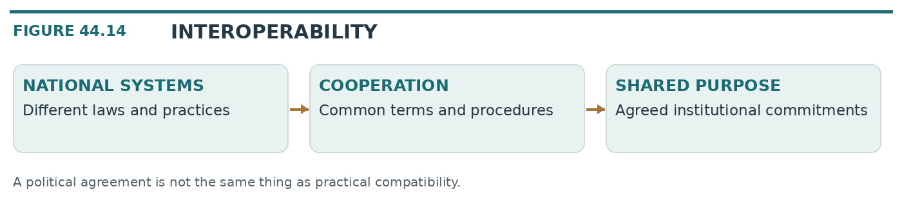

An alliance is a political arrangement among states; a multinational military institution must also address practical differences in language, procedures, legal authority, procurement and administration. Interoperability describes the ability of organisations to work together effectively. It does not require that all participants possess identical equipment or political preferences.

NATO's published approach to logistics emphasises cooperation among members, institutional responsibilities, civil preparedness and compatibility. Member states retain important national responsibilities while participating in collective arrangements. These are stated policies of the alliance, not proof that all problems of cooperation have been solved in practice. A critical reader should distinguish a policy document from evidence of its implementation. \[<a href="/044-military-organization-and-logistics/sources/#source-25" class="cite">25</a>\]\[<a href="/044-military-organization-and-logistics/sources/#source-26" class="cite">26</a>\]\[<a href="/044-military-organization-and-logistics/sources/#source-27" class="cite">27</a>\]

A multinational peace operation provides a further example. United Nations arrangements specify terms for personnel, equipment, services and reimbursement supplied by contributing countries. The UN depends on those governments for uniformed personnel rather than possessing a conventional permanent national army of its own. Different national institutions consequently have to work within common mission arrangements. \[<a href="/044-military-organization-and-logistics/sources/#source-28" class="cite">28</a>\]\[<a href="/044-military-organization-and-logistics/sources/#source-29" class="cite">29</a>\] Chapter 45 will examine the diplomatic commitments behind alliances, while Chapter 50 returns to peace operations and reconstruction.

<figure class="figure" id="figure-44-14">

<figcaption>Figure 44.14. A political agreement is not the same thing as practical compatibility. <a class="figure-anchor" href="#figure-44-14" aria-label="Link to this figure">#</a></figcaption>
</figure>
