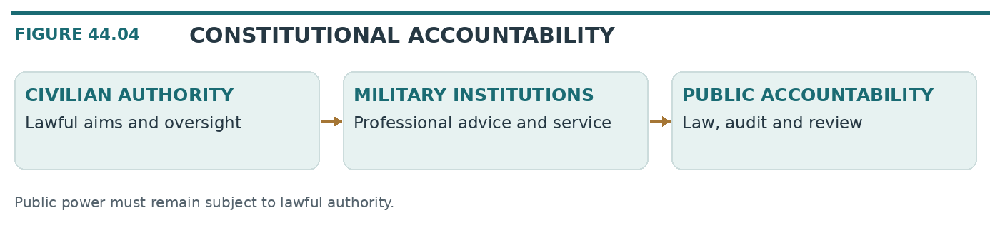

The armed forces have powers that would be extraordinary in most public organisations. In a constitutional democracy, civilian control places those powers under lawful political authority. Elected representatives and executives determine public policy within their respective constitutional responsibilities; military professionals advise and administer the means entrusted to them. Civilian oversight may involve budgets, legislation, appointments, audit, courts and parliamentary committees.

Civilian control does not mean that elected politicians should personally make every technical decision. Nor does professional military expertise give officers the right to displace civilian authority. Both sides face obligations: political authorities must formulate coherent lawful purposes, while military institutions must give candid assessments, respect lawful orders and remain accountable. A constitution can establish a sound formal division while actual practice falls short of it.

The question is particularly important after a revolution, military defeat or political breakdown. Armed institutions may claim that their organisational cohesion qualifies them to govern. But competence in administering an armed force does not establish a right to rule society. The principle of civilian control aims to ensure that the public's military remains a means of lawful government, rather than government becoming a means of the military. \[<a href="/044-military-organization-and-logistics/sources/#source-4" class="cite">4</a>\]\[<a href="/044-military-organization-and-logistics/sources/#source-5" class="cite">5</a>\]

<figure class="figure" id="figure-44-4">

<figcaption>Figure 44.4. Public power must remain subject to lawful authority. <a class="figure-anchor" href="#figure-44-4" aria-label="Link to this figure">#</a></figcaption>
</figure>
