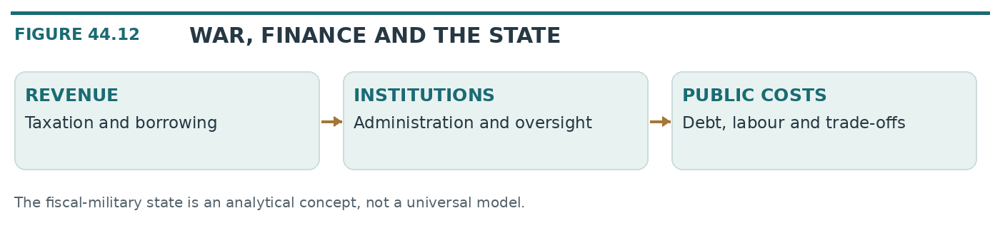

Early modern governments increasingly confronted the financial burden of long wars, fortifications, professional military establishments and naval competition. Their ability to tax, borrow and administer expenditure became an important part of interstate rivalry. Some historians describe the interaction between fiscal institutions and military organisation through the concept of the fiscal-military state. \[<a href="/044-military-organization-and-logistics/sources/#source-17" class="cite">17</a>\]\[<a href="/044-military-organization-and-logistics/sources/#source-18" class="cite">18</a>\]

Public borrowing could distribute the cost of conflict across future years, while taxation linked the armed forces to farmers, merchants and urban households. Financial credibility depended on institutions capable of collecting revenues and honouring obligations. Yet the development of stronger fiscal institutions did not always produce representative government or fair taxation. War could expand state authority, deepen debt and intensify coercion.

The Ottoman Empire provides an instructive comparison. Its early modern military institutions were embedded in a society that extended across Southeastern Europe, Anatolia, the Middle East and North Africa. Rhoads Murphey’s study of Ottoman warfare between 1500 and 1700 places fiscal obligations, provisioning, transportation, material constraints and the experience of ordinary soldiers within that wider political economy. A reader who judges the Ottoman state only by its territorial expansion or the outcome of famous engagements misses the institutions and labour that made those achievements possible. \[<a href="/044-military-organization-and-logistics/sources/#source-37" class="cite">37</a>\]

The concept also has limits. It emerged largely from scholarship on European experiences; it should be used comparatively, not as a template that every society followed. The Ottoman, Mughal and Qing worlds developed their own arrangements for collecting revenue, administering territory and mobilising people. Chapter 30 explored their distinctive political institutions. Military organisation must be placed within the particular economic and social structure of each state, not measured by how closely it resembles an idealised European model.

An eighteenth-century comparison is the expansion of the Qing Empire into Central Eurasia. Peter Perdue’s study of the Qing conquest stresses the combination of military action, economic investment, diplomacy and administration. The Manchu rulers’ defeat of the Zunghar polity was accompanied by the incorporation of extensive frontier territories and severe violence against affected populations. The expansion of imperial rule involved far more than a successful series of campaigns: durable authority required institutions to administer people and territory, and it involved choices about coercion, accommodation and trade. This history illustrates the broader distinction between military achievement and the political construction of an empire. It also reminds us that the same processes that strengthen one state can destroy the security and autonomy of other societies. \[<a href="/044-military-organization-and-logistics/sources/#source-38" class="cite">38</a>\]

<figure class="figure" id="figure-44-12">

<figcaption>Figure 44.12. The fiscal-military state is an analytical concept, not a universal model. <a class="figure-anchor" href="#figure-44-12" aria-label="Link to this figure">#</a></figcaption>
</figure>
