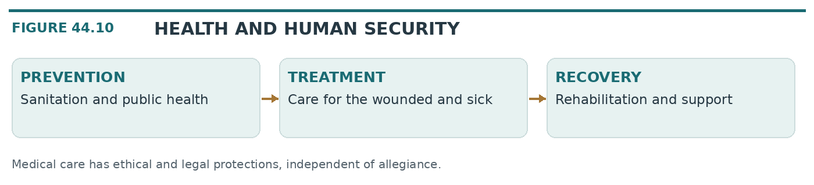

Military history is inseparable from medicine. Infection, contaminated water, malnutrition, exhaustion, climate, accidents and psychological trauma all affect people. Historical sources may record the names of battles more carefully than the conditions in which ordinary personnel lived, creating a distorted picture of the causes of illness and suffering.

Public health, sanitation and medical institutions changed greatly over the nineteenth and twentieth centuries. Better understanding of disease transmission, vaccination, hygiene and surgery transformed many societies. But medical progress did not abolish human vulnerability. Armed conflict also damages civilian health systems precisely when the need for them becomes greatest. Displacement and loss of income can produce harms that continue long after direct violence declines.

Medical services have a legal and ethical status distinct from ordinary military activity. International humanitarian law requires the protection and care of wounded and sick people under applicable rules, including those from an opposing party. Medical personnel, units and transport receive special protections, subject to the relevant legal conditions. The purpose of medicine is care, not a person's political or military affiliation. We return to these obligations in Chapter 46. \[<a href="/044-military-organization-and-logistics/sources/#source-12" class="cite">12</a>\]\[<a href="/044-military-organization-and-logistics/sources/#source-13" class="cite">13</a>\]

<figure class="figure" id="figure-44-10">

<figcaption>Figure 44.10. Medical care has ethical and legal protections, independent of allegiance. <a class="figure-anchor" href="#figure-44-10" aria-label="Link to this figure">#</a></figcaption>
</figure>
