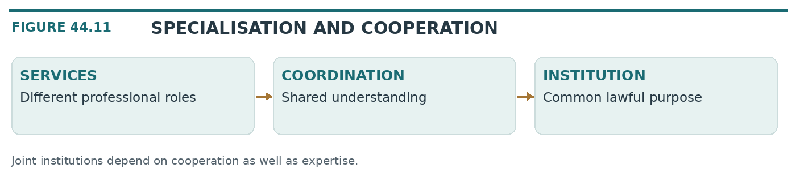

The term joint generally refers to cooperation among different military services, such as land, maritime and air institutions. Combined arms refers more narrowly to the integration of different kinds of military capability. In multinational contexts, combined can also describe forces from different countries. These meanings should not be conflated.

Specialisation enables people and institutions to develop expertise that would be impossible if every person had to perform every task. Specialisation also creates coordination costs. Organisations develop different cultures, professional vocabularies, equipment and budget priorities. A government may find that institutional boundaries encourage departments to optimise their own performance while neglecting the wider public purpose.

The principle can be illustrated through a disaster response involving engineers, emergency medical personnel, police, transport operators and local authorities. Each performs a different lawful function; the contribution of the whole organisation depends on the ability to coordinate them. In military history, technological innovation often increased the importance of such institutional relationships. A study of organisational cooperation should not be mistaken for an assumption that all military institutions can be ranked solely by the sophistication of their technology.

<figure class="figure" id="figure-44-11">

<figcaption>Figure 44.11. Joint institutions depend on cooperation as well as expertise. <a class="figure-anchor" href="#figure-44-11" aria-label="Link to this figure">#</a></figcaption>
</figure>
