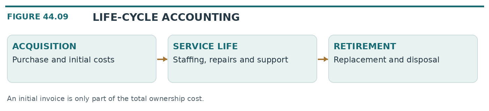

Every machine ages. Components wear, software becomes obsolete, and specialist tools or qualified workers may become unavailable. Acquisition is the process of obtaining an asset; sustainment includes the activities needed to keep it functioning over its intended service life. A low purchase price can therefore be accompanied by high long-term expenditure.

In 2024 the U.S. Government Accountability Office examined how defence institutions reported changes in the operating and support costs of major systems. Its analysis emphasised the importance of consistent records and accountability to Congress. Separate GAO studies of aircraft and ground vehicles illustrate that reported readiness can vary with age, maintenance and parts availability. These are audits of particular American institutions, not universal formulas for every military. \[<a href="/044-military-organization-and-logistics/sources/#source-9" class="cite">9</a>\]\[<a href="/044-military-organization-and-logistics/sources/#source-10" class="cite">10</a>\]\[<a href="/044-military-organization-and-logistics/sources/#source-11" class="cite">11</a>\]

Consider two fictional municipal bus contracts. One supplier offers cheaper vehicles but expensive proprietary servicing; another offers more expensive vehicles with widely available support. A responsible public purchaser compares the entire ownership period rather than only the invoice. The analogy is especially important when reading announcements of military modernisation. A purchase may create financial obligations for many future governments, including training, servicing, facilities and eventual disposal.

<figure class="figure" id="figure-44-9">

<figcaption>Figure 44.9. An initial invoice is only part of the total ownership cost. <a class="figure-anchor" href="#figure-44-9" aria-label="Link to this figure">#</a></figcaption>
</figure>
