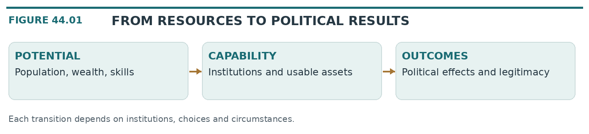

A country's population, economic output, natural resources and technology are sources of potential power. Military capability is the ability of its armed forces to perform particular tasks under particular conditions. Political power is a broader capacity to influence outcomes. These three ideas are related, but the transition between them is not automatic. A wealthy state may lack the institutions needed to turn money into competent public services; an effective armed force may be given an objective that military force alone cannot achieve.

Consider the difference between protecting a country's airspace, contributing personnel to a peacekeeping mission and maintaining a long-term presence overseas. The same personnel and equipment do not necessarily suit all three. Capability is therefore a relational concept: it must be considered against a specified task, environment and opponent or hazard. A league table that assigns one permanent rank to each country's military obscures this important distinction.

Resources must pass through education, procurement, training, administration and maintenance before they become dependable capabilities. The final conversion into political results depends on legitimate authority, diplomacy, the response of other actors and the preferences of affected populations. A state may win military encounters but fail to establish a stable peace. That is not a contradiction; it is a failure to distinguish means from ends. \[<a href="/044-military-organization-and-logistics/sources/#source-2" class="cite">2</a>\]\[<a href="/044-military-organization-and-logistics/sources/#source-3" class="cite">3</a>\]

<figure class="figure" id="figure-44-1">

<figcaption>Figure 44.1. Each transition depends on institutions, choices and circumstances. <a class="figure-anchor" href="#figure-44-1" aria-label="Link to this figure">#</a></figcaption>
</figure>
