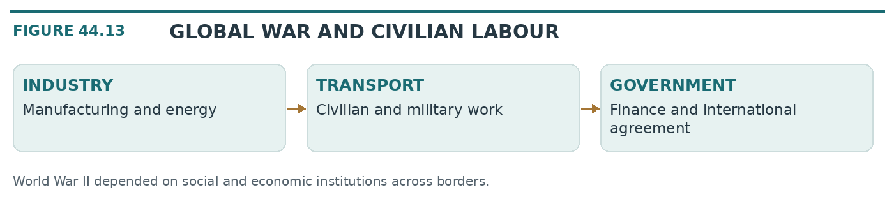

The Second World War involved immense networks of industry, labour, maritime trade, public finance and international cooperation. The United States and Britain had to coordinate strategic priorities across multiple regions, while the Soviet Union experienced enormous destruction and reorganised much of its industrial activity. Asian societies faced occupation, coercion, resistance and disruption of trade on a vast scale. Chapter 40 examined the wider political and human history of the war.

American official histories of wartime logistics emphasise how Allied cooperation complicated and enabled the allocation of resources. They provide a rich institutional record, although their perspective should be complemented by other national and civilian histories. A shipment or factory output was significant only in relation to wider political and economic arrangements. The Allied war effort involved merchant seafarers, railway workers, dock workers and industrial employees as well as military personnel. \[<a href="/044-military-organization-and-logistics/sources/#source-21" class="cite">21</a>\]\[<a href="/044-military-organization-and-logistics/sources/#source-22" class="cite">22</a>\]

The Red Ball Express in 1944 is one historical illustration of the importance of transport labour, including the contribution of African American soldiers serving in a segregated U.S. military. The episode should not be reduced to the ingenuity of a few commanders. Its wider history connects wartime institutional organisation with racial inequality and the distribution of credit for public achievement. \[<a href="/044-military-organization-and-logistics/sources/#source-23" class="cite">23</a>\]

<figure class="figure" id="figure-44-13">

<figcaption>Figure 44.13. World War II depended on social and economic institutions across borders. <a class="figure-anchor" href="#figure-44-13" aria-label="Link to this figure">#</a></figcaption>
</figure>
