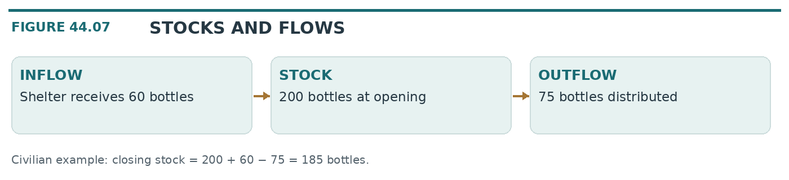

Chapter 7 introduced the distinction between stocks and flows. A stock is an accumulated quantity at a particular moment, while a flow is a quantity entering or leaving a system over an interval. An emergency shelter might have bottled water in a storeroom (stock), deliveries from suppliers (inflow) and water distributed to residents (outflow). If withdrawals persistently exceed deliveries, the stock falls even when the storeroom initially appeared full.

This simple distinction is indispensable for interpreting war economies. A military inventory is a stock. Industrial production and procurement are flows. A large inventory may reflect decades of earlier expenditure and say little about present productive capacity. Conversely, an economy that produces goods steadily may initially hold a smaller stock. Public statistics also differ in what they count: ownership, authorised allocation, physical presence and usable condition are not interchangeable.

A second distinction is between the production of a good and its availability to the institution that needs it. Goods may be awaiting inspection, undergoing repair, delayed in transport or unsuitable for their intended purpose. Counting the same item at several stages can produce an illusion of abundance. The system should be understood as linked activities rather than an impressive aggregate quantity.

<figure class="figure" id="figure-44-7">

<figcaption>Figure 44.7. Civilian example: closing stock = 200 + 60 − 75 = 185 bottles. <a class="figure-anchor" href="#figure-44-7" aria-label="Link to this figure">#</a></figcaption>
</figure>
