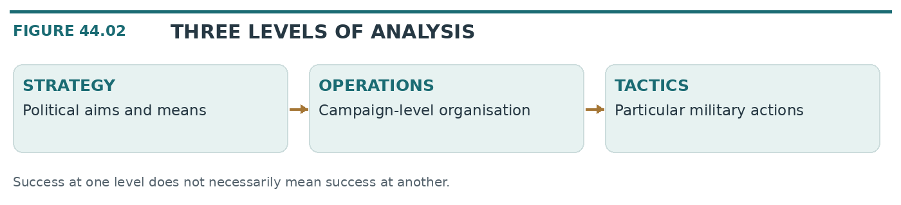

Military writing often distinguishes three levels of analysis. Strategy concerns the relationship between political objectives and the means employed to pursue them. The operational level concerns how military activities are organised across a broader campaign or theatre. Tactics concerns particular military engagements and actions. These are analytical distinctions rather than three floors of a building whose occupants never speak to one another.

A successful local action may have little political value; a small incident may have enormous international consequences. An operation that appears coherent on a military map may undermine negotiations or exceed the authority originally granted by the government. The political level must therefore be able to revise its objectives in the light of events rather than merely demand greater effort from an institution.

Think of the distinction between a football club's strategy for the season, a manager's organisation of a sequence of matches, and the decisions made in an individual match. The analogy helps clarify scale, but war is not a sport: its consequences include death, displacement, legal obligations and the possible destruction of political communities. We use the three levels to interpret history, not to assume that more skilful violence necessarily creates a better political outcome.

<figure class="figure" id="figure-44-2">

<figcaption>Figure 44.2. Success at one level does not necessarily mean success at another. <a class="figure-anchor" href="#figure-44-2" aria-label="Link to this figure">#</a></figcaption>
</figure>
