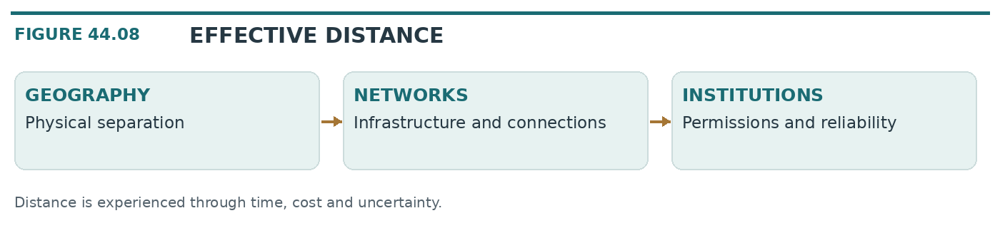

The preceding chapter distinguished physical distance from effective distance. A kilometre across a reliable transport network differs from a kilometre across difficult terrain or a poorly connected border. Transport also has legal and administrative dimensions: vehicles, cargo and people cross jurisdictions, and permissions or customs processes can affect the reliability of journeys.

Ships, railways, road vehicles and aircraft provide different kinds of transport services. Ships carry much of the world's bulk international trade; railways can connect large land-based markets; roads connect dispersed communities; air transport is particularly valuable when time is critical. Each is part of a larger system involving terminals, workers, maintenance, regulations and links to other transport modes.

Historical accounts sometimes treat the appearance of a new transport technology as though it immediately eliminated the older one. In fact, new and old forms often coexist. Railways in the industrial era depended on roads, animals and people to connect places beyond rail stations. Modern transport depends on infrastructure inherited from earlier generations. Geography is transformed by institutions and technology, not abolished by them. \[<a href="/044-military-organization-and-logistics/sources/#source-7" class="cite">7</a>\]\[<a href="/044-military-organization-and-logistics/sources/#source-8" class="cite">8</a>\]

<figure class="figure" id="figure-44-8">

<figcaption>Figure 44.8. Distance is experienced through time, cost and uncertainty. <a class="figure-anchor" href="#figure-44-8" aria-label="Link to this figure">#</a></figcaption>
</figure>
