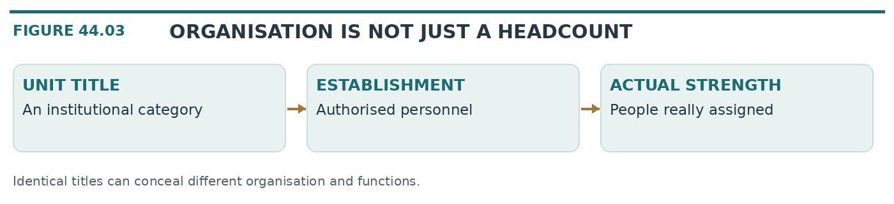

Military institutions divide responsibilities into smaller organisations to make supervision, administration and collective action possible. Familiar land-force labels include squad or section, platoon, company, battalion, brigade, division and corps. A formation is generally a larger grouping of subordinate organisations, although terminology varies. Naval and air organisations use their own labels. A regiment can have an administrative or ceremonial role in one system and a different organisational function in another.

Avoid memorising a single table of unit sizes as though it applied across all history. A battalion in one country is not necessarily identical to a battalion in another. Its authorised establishment may differ from its actual strength. Two units with the same name can have different specialist personnel and equipment. Historical formations might retain impressive titles even after substantial changes in their composition.

Rank is the formal position of an individual within a military hierarchy; appointment describes a particular job or responsibility. The two are related, but not identical. A commander holds delegated authority; a staff officer may have extensive professional influence without personally commanding all the people affected by their advice. Such distinctions explain why reports about generals, brigades or divisions must be read with attention to the institutional context rather than treated as self-explanatory numbers.

<figure class="figure" id="figure-44-3">

<figcaption>Figure 44.3. Identical titles can conceal different organisation and functions. <a class="figure-anchor" href="#figure-44-3" aria-label="Link to this figure">#</a></figcaption>
</figure>
