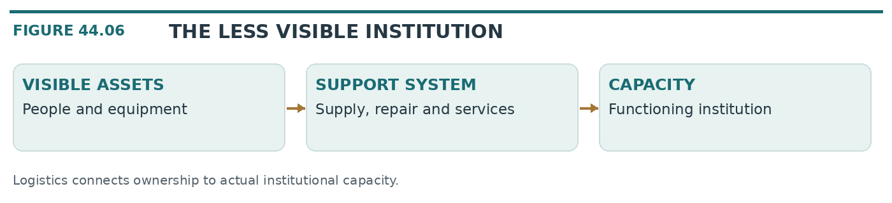

Logistics concerns the movement and provision of the people, goods and services required by an organisation. Military logistics includes transport, supply, storage, maintenance and other support functions; sustainment is often used for the broader activity of maintaining a force and its services over time. Doctrinal definitions vary, so neither term should be treated as having one universally fixed boundary.

A useful comparison is a village grocery shop. The shelves are the most visible part of the business, but a shop also requires suppliers, deliveries, refrigeration, cash flow, electricity, workers and inventory records. Owning a refrigerator is not enough if it cannot be repaired or powered. An item ordered from a supplier is not the same as an item received and available for sale. In the same way, the existence of military equipment tells us little about the wider system that makes it usable.

Military historian Martin van Creveld made the problem of supply and movement central to his study of campaigns from early modern Europe onwards. His approach is valuable because it redirects attention from what commanders wished to do to what their institutions could actually support. It is not a universal theory that makes every other explanation unnecessary. Political judgment, leadership, geography, technology and the actions of adversaries remain relevant. \[<a href="/044-military-organization-and-logistics/sources/#source-1" class="cite">1</a>\]\[<a href="/044-military-organization-and-logistics/sources/#source-6" class="cite">6</a>\]

<figure class="figure" id="figure-44-6">

<figcaption>Figure 44.6. Logistics connects ownership to actual institutional capacity. <a class="figure-anchor" href="#figure-44-6" aria-label="Link to this figure">#</a></figcaption>
</figure>
