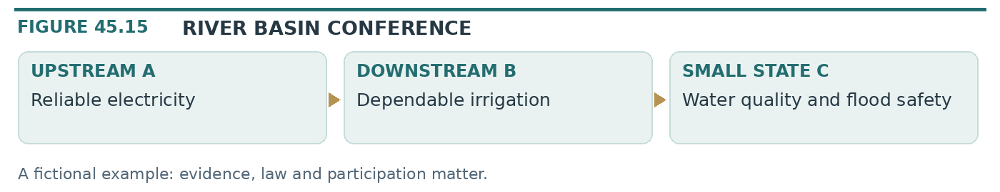

Three fictional governments share a river basin. Upstream A wants reliable electricity; downstream B wants dependable irrigation; small C wants clean drinking water and flood protection. A announces a new infrastructure project. B alleges that the project threatens farmers; A replies that it has a sovereign right to development. C requests a regional conference. The facts about seasonal flows remain disputed. No actual country or military scenario is represented.

A simplistic analysis labels A aggressive and B defensive, or assumes that both positions are equally justified. A better analysis separates questions: what does hydrological evidence show; what rules already govern the basin; who has authority to negotiate; which communities bear the costs; and what outcomes could each government accept? A scientific panel might help clarify factual disputes. A mediator could help organise discussion. Neither institution alone determines what is fair.

The conference could agree on shared monitoring while leaving allocation unresolved. That would be a partial achievement, not a final settlement. A subsequent agreement could establish transparent procedures for seasonal changes and consultation, subject to applicable law. If governments cannot obtain domestic approval, the international agreement may remain unrealised. Assessing the process requires evidence about implementation over time, not merely a photograph of the signing ceremony.

<figure class="figure" id="figure-45-15">

<figcaption>Figure 45.15. A fictional example: evidence, law and participation matter. <a class="figure-anchor" href="#figure-45-15" aria-label="Link to this figure">#</a></figcaption>
</figure>
