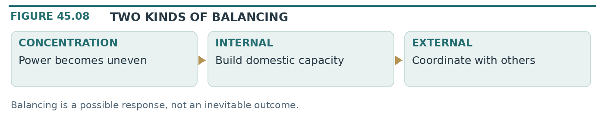

The phrase balance of power has several meanings. It may describe how capabilities are distributed among states; it may refer to a policy intended to prevent dominance; or it may name a theory predicting that states will resist concentrations of power. These meanings should not be collapsed into one another. A distribution can be unequal while governments pursue balancing policies. A policy can fail even if the underlying theory helps explain why it was chosen. \[<a href="/045-diplomacy-alliances-and-balance-of-power/sources/#source-12" class="cite">12</a>\]

Suppose four hypothetical countries possess comparable resources. One grows much stronger than the others. Some neighbours might increase their own capabilities, coordinate with each other or seek outside support. Internal balancing refers to strengthening domestic capacity; external balancing involves cooperation with others. Neither process requires equality in every category. States can be strong in finance, technology or geography and weak in other respects.

Balancing is a possible response to concentration, not a law that automatically produces peace. If governments interpret each other's behaviour incorrectly, their efforts to protect themselves may increase tension. If they cannot cooperate, the strongest state may remain dominant. Smaller states may even welcome a powerful protector. The analyst must investigate why actors interpret a distribution of power in a particular way instead of assuming that arithmetic alone determines policy.

<figure class="figure" id="figure-45-8">

<figcaption>Figure 45.8. Balancing is a possible response, not an inevitable outcome. <a class="figure-anchor" href="#figure-45-8" aria-label="Link to this figure">#</a></figcaption>
</figure>
