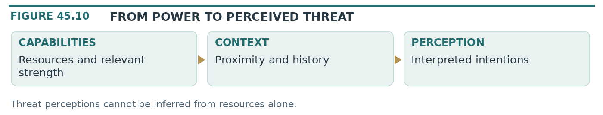

Stephen Walt's balance-of-threat approach argues that alignments respond to perceived threats rather than aggregate power alone. In his account, overall strength, proximity, offensive capability and perceived intentions contribute to threat. A distant powerful country may appear less immediately dangerous than a weaker neighbour with hostile territorial claims. \[<a href="/045-diplomacy-alliances-and-balance-of-power/sources/#source-13" class="cite">13</a>\]

This explains why one cannot infer alliances from gross domestic product or military expenditure alone. The direction of a government's policy may depend on its interpretation of history, prior commitments and the trust it places in particular institutions. Perceptions can be mistaken or politically manipulated. A government may portray a competitor as threatening to consolidate domestic support; another may ignore credible warnings because its leaders assume the competitor is benign.

The theory generates questions to investigate rather than conclusions to accept. Which potential threat did officials actually describe? Did confidential records match public speeches? Were rival governments equally concerned? Did policy change when capabilities changed, or when leaders revised their expectations? Evidence about threat perceptions helps distinguish competing explanations. It does not justify a state's conduct merely because its leaders claim to feel threatened.

<figure class="figure" id="figure-45-10">

<figcaption>Figure 45.10. Threat perceptions cannot be inferred from resources alone. <a class="figure-anchor" href="#figure-45-10" aria-label="Link to this figure">#</a></figcaption>
</figure>
