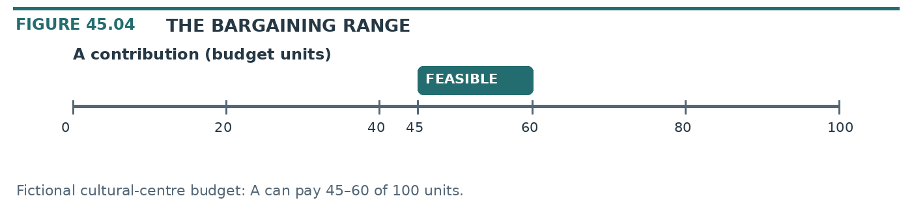

A bargaining range is the set of outcomes that all parties would prefer to their relevant alternatives. Imagine a fictional cultural centre that two municipalities want to fund jointly. Town A can contribute at most 60 of 100 budget units; Town B can contribute at most 55. If there are no other constraints, A's acceptable contribution lies between 45 and 60, because B must be able to cover the remainder. There is a range rather than a unique fair answer. The figures are invented for teaching; they are not a model of real military crises.

The example shows why sharing an interest does not eliminate disagreement about distribution. Both towns prefer a centre to none, yet each would rather keep more money for other services. An agreement at A=50 and B=50 is feasible; so is A=58 and B=42. We need additional principles or bargaining history to judge which is fair. If the total cost rises to 120 and neither can expand its budget, no division within the original limits will finance the project.

International agreements are more complicated because alternatives and preferences may be uncertain, multidimensional and changing. James Fearon's work on war asks why actors sometimes fail to locate a less costly agreement even when conflict imposes losses. The bargaining model clarifies a puzzle; it does not imply that actual leaders possess accurate probabilities or that justice can be reduced to utility. \[<a href="/045-diplomacy-alliances-and-balance-of-power/sources/#source-7" class="cite">7</a>\]

<figure class="figure" id="figure-45-4">

<figcaption>Figure 45.4. Fictional cultural-centre budget: A can pay 45–60 of 100 units. <a class="figure-anchor" href="#figure-45-4" aria-label="Link to this figure">#</a></figcaption>
</figure>
