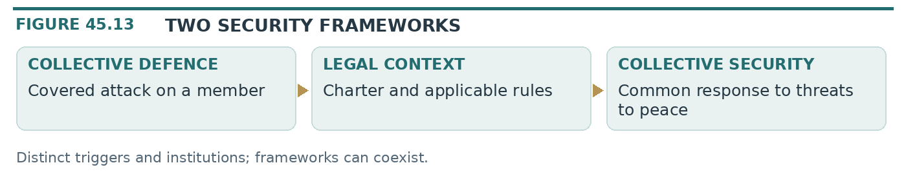

Collective defence is an arrangement under which members undertake to assist one another against attack under specified conditions. Collective security aims more broadly to organise responses to threats to peace through a common system, potentially involving action against a member or nonmember responsible for aggression. The two ideas can coexist: an alliance may rely on the right of collective self-defence recognised by the UN Charter while participating in a wider collective-security framework. \[<a href="/045-diplomacy-alliances-and-balance-of-power/sources/#source-6" class="cite">6</a>\]\[<a href="/045-diplomacy-alliances-and-balance-of-power/sources/#source-17" class="cite">17</a>\]

The difference is not merely the number of members. A regional institution can have collective-security functions, and a large alliance can remain an arrangement for defence of its parties. A central question is what triggers action and who has authority to decide. Under the UN Charter, the Security Council has primary responsibility for international peace and security; Article 51 recognises individual and collective self-defence subject to its conditions. These are different legal bases.

A collective-security organisation does not possess magical enforcement capacity. Member states must provide political support and resources, and decisions may be blocked by disagreement. A defence alliance similarly depends on credible cooperation and national implementation. The difference between a legal obligation and effective institutional action is one of the most important themes of this chapter.

<figure class="figure" id="figure-45-13">

<figcaption>Figure 45.13. Distinct triggers and institutions; frameworks can coexist. <a class="figure-anchor" href="#figure-45-13" aria-label="Link to this figure">#</a></figcaption>
</figure>
