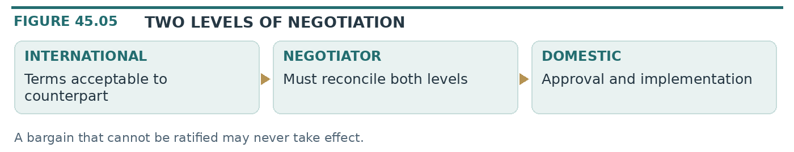

Imagine a trade minister negotiating a cross-border agreement. At the international table, the minister must find terms acceptable to another government. At home, the agreement must survive parliamentary debate, legal review and objections from affected industries. A concession that makes the foreign government happy may make ratification impossible; a domestically popular promise may be unacceptable abroad. Robert Putnam described this interaction through the metaphor of two-level games. \[<a href="/045-diplomacy-alliances-and-balance-of-power/sources/#source-8" class="cite">8</a>\]

Domestic constraints can be genuine or exaggerated. A leader who claims that parliament will never approve a proposal may be accurately describing a legislative majority, or may be using the claim rhetorically. An outside observer cannot tell from the statement alone. Constitutional rules, election calendars, coalition agreements, public opinion and the distribution of economic costs can provide independent evidence.

The metaphor also prevents us from treating a country as a single person with a single desire. Ministries, courts, firms, unions, regional authorities and citizens may have conflicting priorities. In authoritarian systems, public disagreement may be restricted, but elite politics and administrative limits do not disappear. Agreements that ignore domestic institutions can look impressive at the moment of signing and then fail during implementation.

<figure class="figure" id="figure-45-5">

<figcaption>Figure 45.5. A bargain that cannot be ratified may never take effect. <a class="figure-anchor" href="#figure-45-5" aria-label="Link to this figure">#</a></figcaption>
</figure>
