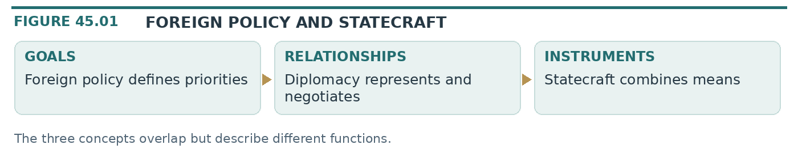

Foreign policy is the broad set of goals and choices through which a government deals with the world outside its jurisdiction. Diplomacy is the activity of representing interests and communicating, negotiating or managing relationships with other international actors. Statecraft is broader still: it includes diplomatic, economic, legal and other instruments of influence. A government deciding to improve access to foreign markets is making foreign policy; its ambassador discussing customs rules is practising diplomacy; the combination of domestic legislation, trade negotiations and financial policy is statecraft. \[<a href="/045-diplomacy-alliances-and-balance-of-power/sources/#source-1" class="cite">1</a>\]

Not all diplomacy is conducted by foreign ministers. Heads of government, international organisations, specialist ministries, regional administrations and appointed envoys can take part. Informal meetings among researchers or former officials can support official processes without having authority to bind governments. The diplomatic profession remains distinctive because authorised representatives speak for institutions rather than merely for themselves. That authority has limits. A personal assurance by a delegate may not amount to a legally binding undertaking.

The word diplomacy sometimes implies politeness in everyday speech. International diplomacy can be courteous, blunt, secretive or coercive; its presence tells us little about moral character. It can help secure a ceasefire or negotiate an unjust settlement. A careful reader must therefore distinguish a method from the goals for which it is used. Political legitimacy and international legality are separate questions from whether a bargaining effort was effective.

<figure class="figure" id="figure-45-1">

<figcaption>Figure 45.1. The three concepts overlap but describe different functions. <a class="figure-anchor" href="#figure-45-1" aria-label="Link to this figure">#</a></figcaption>
</figure>
