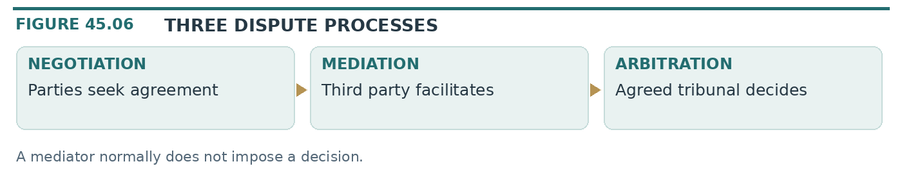

In direct negotiation, the parties speak with each other. Mediation introduces a third party to facilitate communication and help explore a settlement; a mediator ordinarily does not impose a decision. Arbitration submits a dispute to an agreed tribunal whose decision may bind the parties under the applicable framework. Judicial settlement refers to resolution by a court with jurisdiction, for example the International Court of Justice in cases within its jurisdiction. These are different institutions, not synonyms for conversation. \[<a href="/045-diplomacy-alliances-and-balance-of-power/sources/#source-6" class="cite">6</a>\]\[<a href="/045-diplomacy-alliances-and-balance-of-power/sources/#source-9" class="cite">9</a>\]

Mediation is not simply choosing a respected neutral person. The United Nations guidance emphasises a set of conditions including consent, inclusion, preparedness, ownership and legal principles. A settlement negotiated among powerful elites can stop immediate violence yet fail to protect groups absent from the table. Impartial procedure does not require treating established facts as uncertain, or treating a victim's rights and an unlawful demand as morally equivalent. \[<a href="/045-diplomacy-alliances-and-balance-of-power/sources/#source-9" class="cite">9</a>\]

A successful process must be judged against the problem it addresses. A temporary arrangement protecting humanitarian access is valuable even if political negotiations remain unresolved. Conversely, an announcement of a comprehensive agreement may mean little if there is no lawful authority, implementation mechanism or participation by affected communities. Diplomacy has intermediate achievements and failures, not just victory or defeat.

<figure class="figure" id="figure-45-6">

<figcaption>Figure 45.6. A mediator normally does not impose a decision. <a class="figure-anchor" href="#figure-45-6" aria-label="Link to this figure">#</a></figcaption>
</figure>
